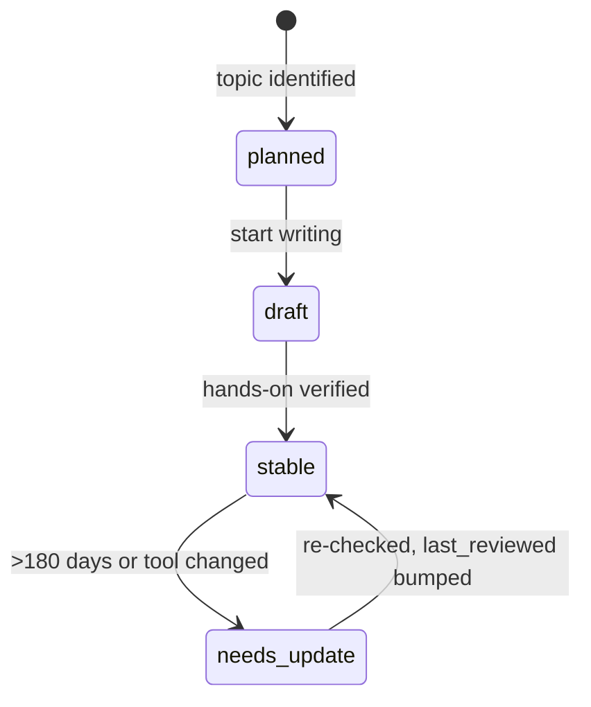

# How to add & update topics

Every topic is **one Markdown file** inside an area folder under `docs/`. Navigation, section tables,
the [catalog](../catalog.md), counts on the home page and [tags](../tags.md) all
update automatically.

## Add a topic

=== "With make"

    ```bash
    make new SECTION=mcp SLUG=building-a-server TITLE="Building an MCP server"
    ```

=== "With Python"

    ```bash
    python3 scripts/new_topic.py mcp building-a-server "Building an MCP server"
    ```

=== "By hand / on GitHub"

    Copy [`templates/topic.md`](template.md) to `docs/<area>/<slug>.md` and replace the
    `{{TITLE}}`, `{{SECTION}}` and `{{DATE}}` placeholders.

Area folders, by group:

| Group | Folders |
| --- | --- |
| Learn | `fundamentals` · `models` · `rag` · `multimodal` |
| Tools | `harnesses` · `skills` · `mcp` · `connectors` · `products` |
| Build | `apis` · `evals` · `security` · `customization` |
| Apply | `automation` · `playbooks` · `use-cases` · `labs` |
| Stay Current | `radar` |

!!! note "Adding a new area"
    Create `docs/<folder>/index.md` (copy any area's `index.md`), add the folder to its group in
    `docs/.nav.yml`, add a card to the home page, and note it in the [changelog](../changelog.md).

!!! tip "Big topics"
    When a subject grows beyond one page (for example a specific harness), use a nested slug —
    `make new SECTION=harnesses SLUG=claude-code/hooks TITLE="Hooks"` — and add a
    `docs/harnesses/claude-code/index.md` overview page.

## Front matter reference

| Field | Values | Purpose |
| --- | --- | --- |
| `title` | text | Page title used in tables and search |
| `description` | one sentence | Shown in the section table and catalog |
| `status` | `planned` · `draft` · `stable` · `needs-update` | Marks the page as a topic and tracks progress |
| `level` | `beginner` · `intermediate` · `advanced` | Helps readers pick the right starting point |
| `time` | e.g. `30 min` | Rough time to learn and try it |
| `last_reviewed` | `YYYY-MM-DD` | Drives the "recently reviewed" list and stale flags |
| `tags` | list | Cross-area grouping on the [tags page](../tags.md). Radar notes add a ring: `adopt`, `trial`, `assess` or `hold` |

A page counts as a topic **only if it has a `status` field** — section overviews and reference pages
leave it out.

## Topic lifecycle



1. **planned** — you know you want to learn it; the file holds a title and a few links.
2. **draft** — notes are going in; hands-on may not be verified yet.
3. **stable** — you have run the hands-on yourself and the content is reliable.
4. **needs-update** — the tool changed or the review date is older than 180 days.

## Updating a topic

1. Edit the file (or click the :material-file-edit-outline: edit button at the top of any page).
2. Bump `last_reviewed` to today.
3. Add a line to the topic's *Changelog* table.
4. If the change is structural (new area, new convention), add it to the
   [hub changelog](../changelog.md).

## Writing guidelines

- **Lead with the TL;DR.** A reader should be able to act after three sentences.
- **Show, don't describe.** Prefer a command or config you actually ran over a paragraph about it.
- **Date volatile facts.** Prices, limits and version numbers go stale — note when you checked them.
- **Link, don't duplicate.** Link to the official docs and to other topics instead of copying them.
- **One topic, one idea.** If a page needs more than one *Hands-on* section, split it.

## Preview locally

```bash
make install   # once
make serve     # live preview at http://127.0.0.1:8000
make build     # strict build — the same check CI runs
```

Pushing to `main` publishes the site to GitHub Pages automatically.
