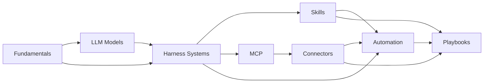

# Start Here

Welcome! This hub is a personal, living knowledge base for AI. It is designed around four goals:

| Goal | How the hub supports it |
| --- | --- |
| **Easy access** | Top tabs per area, instant search (++slash++), a [catalog of every topic](../resources/catalog.md), [tags](../resources/tags.md) and a [glossary](../resources/glossary.md). |
| **Learning** | Every topic follows the same template, with a level (beginner → advanced), a time estimate and a self-check list. [Learning paths](learning-paths.md) suggest an order. |
| **Updating** | One Markdown file per topic, a `status` and `last_reviewed` date on each, automatic stale flags, and an *edit* button on every page. |
| **Practical application** | Hands-on walkthroughs, a "practical applications" table on every topic, and [Playbooks](../playbooks/index.md) for end-to-end workflows. |

## How the content is organised

| Area | Question it answers |
| --- | --- |
| [Fundamentals](../fundamentals/index.md) | *How does this stuff actually work?* |
| [LLM Models](../models/index.md) | *Which model should I use, and what does it cost?* |
| [Harness Systems](../harnesses/index.md) | *Which tool runs the agent, and how do I configure it?* |
| [Skills](../skills/index.md) | *How do I teach an agent a repeatable job?* |
| [MCP](../mcp/index.md) | *How do I give an agent access to tools and data?* |
| [Connectors](../connectors/index.md) | *Which off-the-shelf integrations exist and how do I use them?* |
| [Automation](../automation/index.md) | *How do I run AI without babysitting it?* |
| [Playbooks](../playbooks/index.md) | *How do I put it all together to solve a real problem?* |

## Reading a topic page

Every topic shows a metadata line under its title:

- **Level** — :material-signal-cellular-1: beginner, :material-signal-cellular-2: intermediate, :material-signal-cellular-3: advanced
- **Status** — :material-calendar-blank-outline: planned, :material-pencil-outline: draft, :material-check-decagram: stable, :material-update: needs update
- **Time** — a rough estimate to learn and try it
- **Reviewed** — when the content was last checked; :material-alert: means it is due for review

## Next steps

- Pick a [learning path](learning-paths.md)
- Browse the [topic catalog](../resources/catalog.md)
- Add your first topic: [How to add & update topics](../resources/contribute/index.md)
