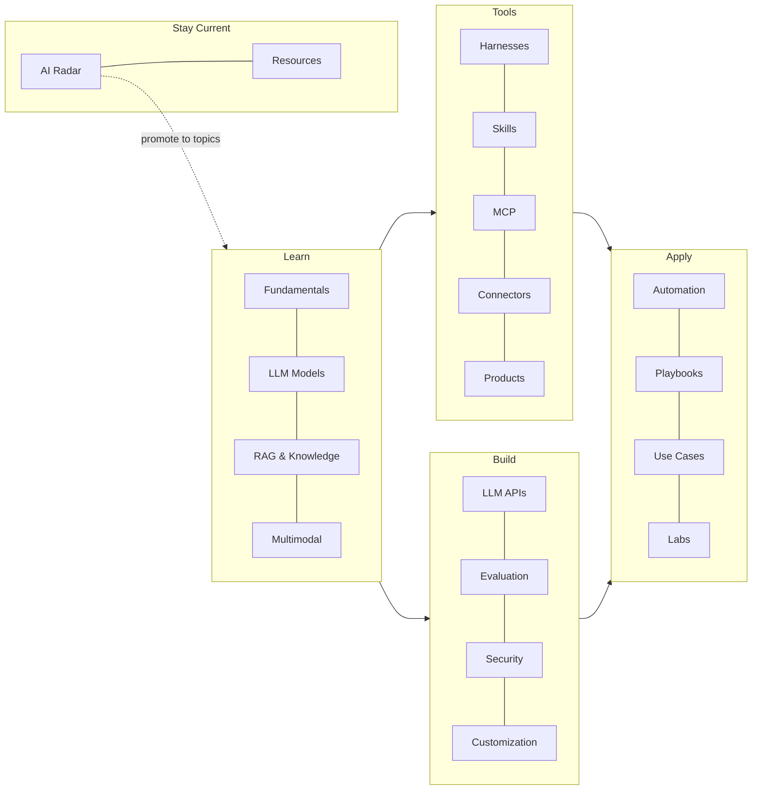

# Start Here

Welcome! This hub is a personal, living knowledge base for AI. It is designed around four goals:

| Goal | How the hub supports it |
| --- | --- |
| **Easy access** | Top tabs per area, instant search (++slash++), a [catalog of every topic](../resources/catalog.md), [tags](../resources/tags.md) and a [glossary](../resources/glossary.md). |
| **Learning** | Every topic follows the same template, with a level (beginner → advanced), a time estimate and a self-check list. [Learning paths](learning-paths.md) suggest an order. |
| **Updating** | One Markdown file per topic, a `status` and `last_reviewed` date on each, automatic stale flags, an *edit* button on every page, and the [AI Radar](../radar/index.md) for news. |
| **Practical application** | Hands-on walkthroughs and a "practical applications" table on every topic, plus [Playbooks](../playbooks/index.md), [Use Cases by Role](../use-cases/index.md) and [Labs](../labs/index.md). |

## How the content is organised

The hub has **18 areas in five groups** — one tab per group in the top bar.

| Group | Area | Question it answers |
| --- | --- | --- |
| **Learn** | [Fundamentals](../fundamentals/index.md) | *How does this stuff actually work?* |
| | [LLM Models](../models/index.md) | *Which model should I use, and what does it cost?* |
| | [RAG & Knowledge](../rag/index.md) | *How do I ground AI in my own information?* |
| | [Multimodal](../multimodal/index.md) | *How do I work with images, documents, audio and video?* |
| **Tools** | [Harness Systems](../harnesses/index.md) | *Which agent tool should I use, and how do I configure it?* |
| | [Skills](../skills/index.md) | *How do I teach an agent a repeatable job?* |
| | [MCP](../mcp/index.md) | *How do I give an agent access to tools and data?* |
| | [Connectors](../connectors/index.md) | *Which off-the-shelf integrations exist?* |
| | [AI Products & Apps](../products/index.md) | *Which app is best for this task?* |
| **Build** | [Building with LLM APIs](../apis/index.md) | *How do I build AI into my own code?* |
| | [Evaluation & Observability](../evals/index.md) | *How do I know it works — and keeps working?* |
| | [Security & Governance](../security/index.md) | *How do I use AI safely and within the rules?* |
| | [Customization](../customization/index.md) | *Should I fine-tune or self-host, and how?* |
| **Apply** | [Automation](../automation/index.md) | *How do I run AI without babysitting it?* |
| | [Playbooks](../playbooks/index.md) | *How do I solve a real problem end to end?* |
| | [Use Cases by Role](../use-cases/index.md) | *What can AI do for my job?* |
| | [Labs](../labs/index.md) | *How do I practise and prove I've learned it?* |
| **Stay Current** | [AI Radar](../radar/index.md) | *What's new, and is it worth my time?* |
| | [Resources](../resources/index.md) | *Where's the catalog, glossary and contributing guide?* |

## Reading a topic page

Every topic shows a metadata line under its title:

- **Level** — :material-signal-cellular-1: beginner, :material-signal-cellular-2: intermediate, :material-signal-cellular-3: advanced
- **Status** — :material-calendar-blank-outline: planned, :material-pencil-outline: draft, :material-check-decagram: stable, :material-update: needs update
- **Time** — a rough estimate to learn and try it
- **Reviewed** — when the content was last checked; :material-alert: means it is due for review

## Next steps

- Pick a [learning path](learning-paths.md)
- Browse the [topic catalog](../resources/catalog.md)
- Add your first topic: [How to add & update topics](../resources/contribute/index.md)
